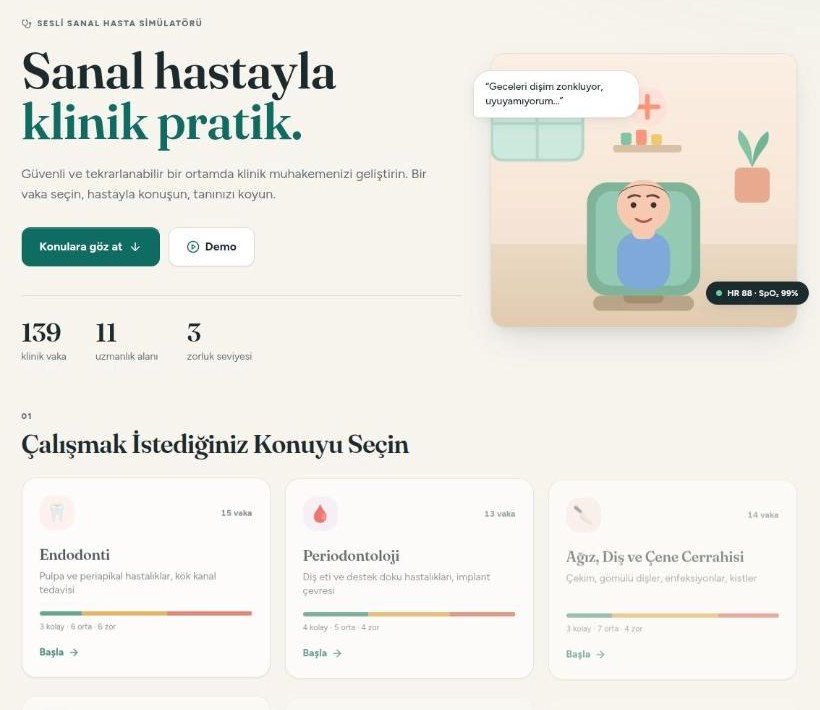
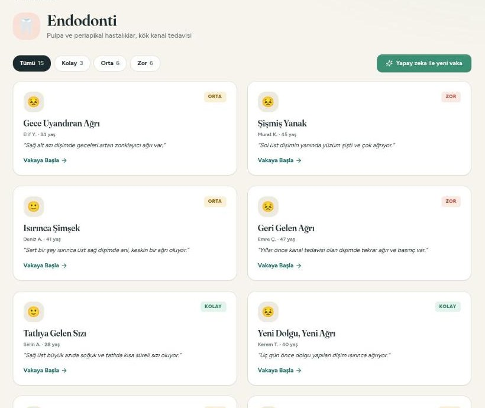

# Vaka: a virtual-patient simulator for dental students

**Live app:** https://vaka-z1na.onrender.com &nbsp;·&nbsp; Turkish by default, English one click away.

Students pick a specialty, choose a case, interview an AI patient (by voice or text), examine, order tests, commit to a
diagnosis and treatment plan, and get an examiner-style, rubric-scored debrief. 139 authored cases across 11 specialties
and three difficulty levels. It is an educational tool, not a clinical decision aid.

| Landing | Topic and case list |
|---|---|
|  |  |

## How it is tested

Every pull request is verified in two independent ways.

**1. TestSprite runs the live app on every PR.** The TestSprite GitHub App is connected to this repository. When the
`deploy gate` CI check completes on a PR, TestSprite runs a 34-test UI suite against the deployed app and posts the
result as a PR comment plus a `TestSprite V3` status check. The suite is generated from
[`docs/TESTSPRITE_PRD.md`](docs/TESTSPRITE_PRD.md), a product requirements document with 25 numbered acceptance
criteria and explicit safe-testing rules (never delete the account, no checkout, no AI case generation). It covers:

- landing page, language toggle and persistence, topic grid (11 topics, counts summing to 139)
- topic filtering by difficulty and "load more" pagination
- case briefing, scoring dimensions (25/20/15/25/15) and the sign-in gate
- the scripted demo, pricing toggles ($9 monthly, $108 struck through / $90 yearly), legal pages
- the signed-in simulation flow: five phases, next-step button, exam and test results, diagnosis, treatment, debrief
- public API contract and security headers

**2. Our own CI** (`.github/workflows/ci.yml`), aggregated into one required check called `deploy gate`:

| Job | What it enforces |
|---|---|
| `backend` | `ruff`, 484 pytest tests on PostgreSQL 16 + Redis 7, Alembic migrations on an empty database, `pip-audit` |
| `frontend` | production build |
| `docker` | image build, then the container must boot and answer `/api/health` |
| `secret-scan` | gitleaks over the full history |

The backend suite is mostly security and data-integrity tests: ownership checks on every route (user A can never read
user B's sessions, reports or jobs), a route inventory that fails if any non-public route answers an anonymous request,
rate limits, body-size limits, secret redaction in logs, idempotent scoring under concurrent requests, and the job
queue's retry/timeout/idempotency behaviour. Making `pip-audit` part of the gate paid off immediately: it flagged 14
advisories in the pinned Starlette, which were fixed by upgrading FastAPI.

## Features

- **Topic-first flow:** topic, then case, then briefing, simulation and debrief. 11 specialties from endodontics to
  orofacial pain; easy, moderate and hard in each.
- **AI patient** (Gemini) with hidden clinical facts: it answers only what is asked, in character. Optional natural
  voice (OpenAI TTS) or the browser's speech APIs.
- **Rubric scoring** across history, examination, test stewardship, diagnosis and treatment, with red flags and checklists.
- **Generated cases:** a Postgres-backed job queue (idempotency keys, retries, timeouts) turns the 60-70 s generation
  into a background job with progress.
- **Accounts:** Google sign-in, server-side sessions, plans with quotas, per-user AI spend caps, data export and deletion.
- **Billing** (iyzico subscriptions, monthly $9 / yearly $90): implemented and covered by tests with mocked provider
  responses; sandbox verification is waiting on activation of the Subscription API.

## Architecture

FastAPI + asyncpg (PostgreSQL, Alembic migrations), Redis for cache and rate limits, React 19 + Tailwind, one Docker
image served on Render. Case content lives in `backend/cases/<topic>/*.json` (validated at start-up and by tests);
users, sessions, reports, jobs and the AI-usage ledger live in PostgreSQL. Secrets exist only as backend environment
variables. See [`docs/ARCHITECTURE.md`](docs/ARCHITECTURE.md).

Measured cost of one complete run (generate, play, score, voiced replies) is about **$0.015**, or **$0.003** without
server-side voice: [`docs/COST_MEASUREMENT.md`](docs/COST_MEASUREMENT.md).

## Run it locally

```bash
docker compose -f docker-compose.dev.yml up -d          # Postgres :55432, Redis :56379
cd backend
python -m venv .venv && source .venv/bin/activate
pip install -r requirements-dev.txt
cp .env.example .env                                    # fill DATABASE_URL, SECRET_KEY, GOOGLE_*, GEMINI_*
AUTO_MIGRATE=true uvicorn server:app --reload --port 8001
# second terminal
cd frontend && npm ci --legacy-peer-deps && npm start
# tests
cd backend && pytest -q
```

Without API keys the app still runs; AI replies, case generation and voice are disabled.

## Documentation

| Document | Content |
|---|---|
| [SETUP_GUIDE](docs/SETUP_GUIDE.md) | First deployment: Google OAuth, Render, backup bucket, iyzico, spend limits |
| [ARCHITECTURE](docs/ARCHITECTURE.md) | Components, request flow, data model, jobs, every environment variable |
| [RUNBOOK](docs/RUNBOOK.md) | Deploy, staging to production, rollback, alerts, incident checklist |
| [DISASTER_RECOVERY](docs/DISASTER_RECOVERY.md) | RPO/RTO, backups, restore drills |
| [SECURITY](docs/SECURITY.md) | Environment separation, secret inventory and rotation |
| [PRIVACY_AND_RETENTION](docs/PRIVACY_AND_RETENTION.md) | Data inventory, retention, export and deletion |
| [TESTSPRITE_PRD](docs/TESTSPRITE_PRD.md) | Requirements the TestSprite suite is generated from |

## Honest limitations

- The clinical content is educational and based on public guidelines (AAE, AAP/EFP, IADT, AAOMS, AHA/ADA, AAPD). It has
  **not yet been reviewed by a practising dentist** and must be before real teaching use.
- The legal pages are drafts.
- The Google consent screen, iyzico sandbox and live payments are configured outside the repository.
